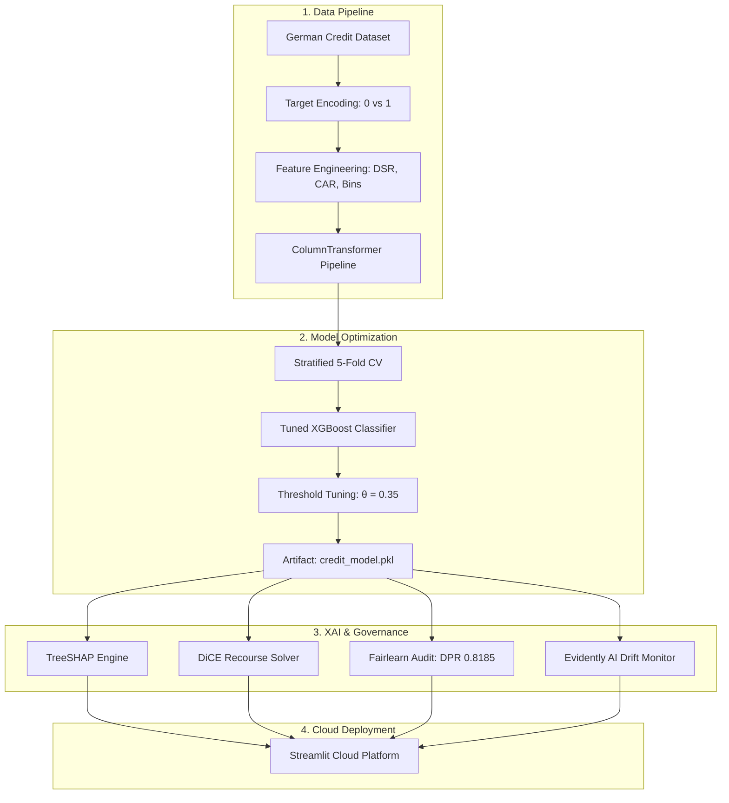
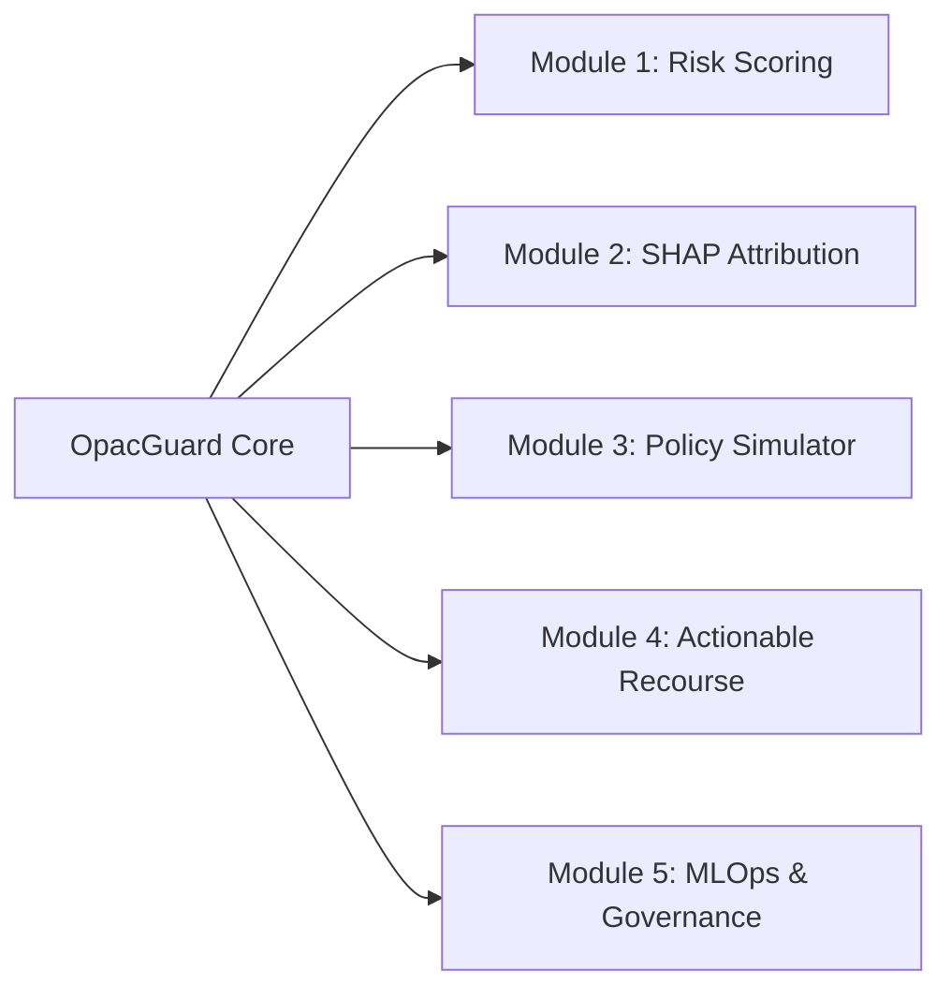

# OpacGuard: An Explainable Machine Learning Framework for Credit Risk Prediction

<p align="center">
  <a href="https://www.python.org/"></a>
  <a href="https://streamlit.io/"></a>
  <a href="https://xgboost.readthedocs.io/"></a>
  <a href="https://scikit-learn.org/"></a>
  <a href="https://shap.readthedocs.io/"></a>
  <a href="https://fairlearn.org/"></a>
  <a href="https://www.evidentlyai.com/"></a>
  
</p>

---

## 📜 Peer-Reviewed Publication

This repository hosts the official open-source implementation and enterprise decision-support system for the research paper:

> **OpacGuard: An Explainable Machine Learning Framework for Credit Risk Prediction**  
> **Authors:** Aditya Sanjay Manjalkar, Chirag Ashok Mendon, Chaitanya Rajesh Lade, and Prof. Shweta Sharma  
> **Affiliation:** Department of Computer Engineering, Atharva College of Engineering, University of Mumbai, Maharashtra, India  
> **Conference:** Presented at the *4th International Conference on Science, Technology, Engineering & Mathematics for Sustainable Development (ICSTEMSD-2026)*, March 24, 2026.  
> **Journal:** Published in *The Indian Journal of Technical Education (IJTE)*, **Volume 49, Special Issue No. 1**, February 2026.  
> **ISSN:** `0971-3034` | **Publisher:** Indian Society for Technical Education (ISTE), New Delhi.

### 📌 Citation (BibTeX)
```bibtex
@article{manjalkar2026opacguard,
  title={OpacGuard: An Explainable Machine Learning Framework for Credit Risk Prediction},
  author={Manjalkar, Aditya Sanjay and Mendon, Chirag Ashok and Lade, Chaitanya Rajesh and Sharma, Shweta},
  journal={The Indian Journal of Technical Education (IJTE)},
  volume={49},
  number={Special Issue 1},
  pages={1--10},
  year={2026},
  publisher={Indian Society for Technical Education (ISTE)},
  issn={0971-3034},
  note={Presented at ICSTEMSD-2026}
}
```

---

## 🔬 Abstract

Credit risk assessment is historically dominated by either oversimplified linear credit scorecards or opaque, black-box ensemble architectures. While non-linear gradient-boosted trees offer superior predictive accuracy, their deployment in heavily regulated consumer lending is constrained by strict adverse action notice mandates (e.g., US Equal Credit Opportunity Act - ECOA, Fair Credit Reporting Act - FCRA, and EU AI Act Article 14).

**OpacGuard** bridges this critical gap by introducing a multi-tiered, explainable machine learning framework for credit risk decisioning. Trained on the benchmark Statlog German Credit dataset, our framework integrates:
1. **Cost-Sensitive Gradient Boosting:** An optimized XGBoost pipeline trained under 5-Fold Stratified Cross-Validation with an asymmetric loss threshold (θ = 0.35), elevating minority default detection (recall) from 52% to 67% (F1 = 0.61, AUC-ROC = 0.78).
2. **Local & Global Interpretability:** Game-theoretic feature attributions via TreeSHAP with feature mapping that translates high-dimensional one-hot interactions into plain-language credit metrics.
3. **Actionable Recourse & Counterfactuals:** A dual-engine recommendation mechanism combining heuristic recovery planning with mathematical counterfactual generation via Diverse Counterfactual Explanations (DiCE), calculating the minimum feature adjustments required to reverse adverse loan decisions.
4. **Regulatory MLOps Governance:** Quantitative algorithmic fairness audits under Fairlearn demonstrating a Demographic Parity Ratio of 0.8185 (clearing the US EEOC Four-Fifths compliance threshold), coupled with Evidently AI telemetry monitoring for macroeconomic inflation drift.

---

## 🏛 System Architecture

The following diagram illustrates the complete end-to-end data flow, feature engineering, modeling, interpretability, and MLOps governance layers:



---

## 🧮 Theoretical Formulation & Methodology

### 1. Domain-Specific Feature Engineering
To capture nonlinear debt repayment friction without data leakage, custom transformers construct credit risk ratios:

* **Debt Service Ratio (DSR):**
$$
\text{DSR} = \frac{\text{Credit Amount}}{\text{Loan Duration (Months)}}
$$

* **Capital-to-Age Ratio (CAR):**
$$
\text{CAR} = \frac{\text{Credit Amount}}{\text{Applicant Age (Years)}}
$$

* **Variance-Stabilizing Logarithmic Transforms:**
$$
z_{\text{amount}} = \ln(1 + \text{Credit Amount}), \quad z_{\text{duration}} = \ln(1 + \text{Duration})
$$

* **Non-linear Age Discretization:** Partitioning continuous age into regulatory cohorts:
$$
\text{AgeBin} \in \{[18, 25), [26, 35), [36, 45), [46, 55), [56, 65), [65, 100]\}
$$

---

### 2. Cost-Sensitive Objective & Asymmetric Loss
In consumer credit underwriting, the capital cost of a **False Negative** (misclassifying a defaulting borrower as creditworthy, leading to loan principal charge-off) is substantially higher than a **False Positive** (erroneously rejecting a solvent borrower, resulting in lost interest margin):

$$
C(\text{FN}) \approx 4 \times C(\text{FP})
$$

Rather than using a default symmetric threshold ($\theta = 0.50$), OpacGuard applies an asymmetric decision threshold $\theta^* = 0.35$:

$$
y^* = \mathbb{I}\left(P(y=1 \mid \mathbf{x}) \ge 0.35\right)
$$

---

### 3. FICO Credit Score Calibration
To provide applicants and underwriters with standardized scoring, posterior default probabilities are scaled linearly to the standard FICO score interval $[300, 850]$:

$$
\text{Score}_{\text{FICO}} = 850 - 550 \times P(y=1 \mid \mathbf{x})
$$

---

### 4. Game-Theoretic Feature Attribution (TreeSHAP)
For tree ensemble model $f(\mathbf{x})$, local feature contributions $\phi_i(f, \mathbf{x})$ are computed via Shapley value formulation:

$$
\phi_i(f, \mathbf{x}) = \sum_{S \subseteq \mathcal{F} \setminus \{i\}} \frac{|S|!(|\mathcal{F}| - |S| - 1)!}{|\mathcal{F}|!} \left[ f_x(S \cup \{i\}) - f_x(S) \right]
$$

where $\mathcal{F}$ represents the full set of engineered and one-hot encoded input variables.

---

### 5. Algorithmic Recourse via Constrained Counterfactuals (DiCE)
Adverse action notices require actionable recourse. Using Diverse Counterfactual Explanations, we minimize loss function $C(\mathbf{x}, \mathbf{c})$ to locate the closest perturbed vector $\mathbf{c}$ yielding approval ($\hat{y} = 0$):

$$
\mathbf{c}^* = \arg\min_{\mathbf{c}} \text{dist}(\mathbf{x}, \mathbf{c}) + \lambda \left( f(\mathbf{c}) - 0 \right)^2
$$

subject to realistic feasibility bounds on mutable features: $\text{Duration} \in [6, 72]$ months and $\text{Amount} \in [250, 15000]$ DM.

---

### 6. Algorithmic Fairness & Disparate Impact Formulation
To audit age-related bias between protected classes (Sensitive attribute $A \in \{\text{Young } (<25), \text{Older } (\ge 25)\}$), Demographic Parity Difference ($DPD$) and Demographic Parity Ratio ($DPR$) are computed with favorable outcome $Y=0$ (Approval):

$$
DPR = \frac{P(\hat{Y} = 0 \mid A = \text{Young})}{P(\hat{Y} = 0 \mid A = \text{Older})}
$$

Regulatory compliance under the US Equal Employment Opportunity Commission (EEOC) Uniform Guidelines requires:

$$
\text{Compliance Condition: } DPR \ge 0.80 \quad \text{(The Four-Fifths Standard)}
$$

---

## 📊 Experimental Results & Benchmark Evaluation

### 1. Cross-Model Empirical Benchmarking
Models were evaluated using 5-Fold Stratified Cross-Validation on held-out test distributions:

| Model Architecture | Accuracy | Precision | Recall (Default Capture) | F1-Score | AUC-ROC | Research Notes |
| :--- | :---: | :---: | :---: | :---: | :---: | :--- |
| **Dummy (Zero-Rule Baseline)** | 0.70 | 0.00 | 0.00 | 0.00 | 0.50 | Majority class assignment |
| **Decision Tree (CART)** | 0.66 | 0.43 | 0.43 | 0.43 | 0.59 | High variance on minority class |
| **L2-Regularized Logistic Regression** | 0.79 | **0.70** | 0.53 | 0.60 | **0.80** | Strong linear parametric baseline |
| **XGBoost (Default @ θ = 0.50)** | 0.78 | 0.65 | 0.55 | 0.59 | 0.77 | Sub-optimal default capture |
| **XGBoost (Tuned @ θ = 0.50)** | **0.78** | 0.66 | 0.52 | 0.58 | 0.78 | Stratified CV optimal parameters |
| **OpacGuard XGBoost (Tuned @ θ = 0.35)** | 0.74 | 0.56 | **0.67** | **0.61** | 0.78 | **Production Operating Point (+15% recall)** |

> **Key Observation:** Transitioning to the cost-sensitive threshold $\theta = 0.35$ increases default detection recall by $+15.0\%$ absolute ($52\% \rightarrow 67\%$), mitigating the highest source of bank financial risk with minimal impact on overall accuracy.

---

### 2. Algorithmic Fairness Audit Findings (`fairlearn`)

An algorithmic fairness audit was conducted on the sensitive attribute `Age` ($< 25$ vs. $\ge 25$):

| Protected Demographic Cohort | Sample Size (N) | Approval Rate | Empirical Accuracy |
| :--- | :---: | :---: | :---: |
| **Older Applicants (Age ≥ 25)** | 851 | 74.62% | 93.77% |
| **Young Applicants (Age < 25)** | 149 | 61.07% | 89.93% |

* **Demographic Parity Difference (DPD):** `0.1354`
* **Demographic Parity Ratio (DPR / Disparate Impact):** **`0.8185`**
* **Regulatory Compliance Verdict:** **PASSED.** The model achieves a disparate impact ratio of $81.85\%$, successfully clearing the regulatory $80\%$ Four-Fifths threshold ($0.8185 \ge 0.80$).

---

## 🖥 Production Decision Platform (Streamlit UI)

The web dashboard (`streamlit_app.py`) provides an interactive interface across five specialized enterprise modules:



### Module Technical Specifications

| Module | Core Functionality | Primary KPIs & Visualizations | Technical Implementation |
| :--- | :--- | :--- | :--- |
| **1. Credit Risk Scoring** | Real-time borrower default risk prediction and credit score conversion | • Decision Label (Approved / Denied)<br>• Calibrated Risk Probability P(Default)<br>• Plotly FICO Score Gauge (300–850)<br>• Dynamic Risk Tier (Poor, Fair, Good, Excellent) | Evaluates engineered features against the serialized XGBoost pipeline; maps probability linearly to FICO scale: Score = 850 - 550 · P(Default). |
| **2. SHAP Attribution Engine** | Local and global game-theoretic model explainability | • Single-applicant SHAP waterfall plot<br>• Top feature impact bar charts<br>• Interactive bivariate SHAP dependence plots with background cohort | Uses `shap.TreeExplainer` on the transformed feature matrix with human-readable feature label mapping (`shap_mean_abs_importance.csv`). |
| **3. Enterprise Policy Simulator** | Dynamic executive policy threshold stress-testing | • Chief Risk Officer (CRO) threshold slider (0.10 to 0.90)<br>• Plotly Bullet Chart comparing applicant risk against company policy<br>• Real-time policy regime indicator (Conservative / Balanced / Aggressive) | Re-classifies active applicant in real-time under modified risk tolerance thresholds without retraining or latency. |
| **4. Actionable Recourse & Recs** | What-if simulation, adverse action guidance, and exact counterfactuals | • 6 ranked financial optimization levers with estimated FICO gains (+pts)<br>• 12-month exponential score recovery trajectory curve<br>• Live parameter sliders (Loan Amount, Duration)<br>• Downloadable Adverse Action Plan report (.TXT)<br>• Exact DiCE mathematical counterfactuals | Dual-engine architecture: heuristic rule evaluator testing loan cuts, duration shortening, and liquidity boosts, coupled with `dice_ml` randomized counterfactual optimizer. |
| **5. MLOps Admin & Compliance** | Regulatory compliance auditing, disparate impact analysis, and macroeconomic drift | • Embedded Fairlearn Demographic Parity audit report<br>• Embedded Evidently AI interactive HTML data drift report<br>• Downloadable SHAP PDF report, CSV mappings, and applicant profiles | Audits age bias (< 25 vs ≥ 25) verifying EEOC Four-Fifths compliance (DPR = 0.8185); detects distribution shifts under simulated 25% inflation stress. |

---

## 🗂 Repository Structure

```
OpacGuard/
├── german.data                          # Raw Statlog German Credit dataset (1,000 samples)
├── german.data-numeric                  # Standardized numeric dataset variant
├── german.doc                           # Dataset documentation and attribute metadata
├── credit_model.pkl                     # Production serialized pipeline artifact (XGBoost + Preprocessor)
├── load_data.py                         # Data ingestion and target standardizer
├── preprocessing.py                     # Custom FeatureEngineer transformer and ColumnTransformer
├── model_artifact.py                    # Decoupled pipeline loader and feature calculation helpers
├── predict.py                           # CLI interactive evaluation tool
├── streamlit_app.py                     # 5-Tab Enterprise Streamlit Application
├── requirements.txt                     # Production frozen dependency manifest
├── EDA_FeatureEngineering.ipynb         # Exploratory data analysis and feature engineering notebook
│
├── backend/                             # Core training and benchmarking suite
│   ├── train_model.py                   # Automated RandomizedSearchCV training pipeline
│   ├── baseline_compare.py              # Multi-model benchmarking script
│   ├── oof_train_shap.py                # 5-Fold Stratified K-Fold Out-of-Fold validation
│   ├── threshold_tuning.py              # Cost-sensitive threshold optimizer
│   ├── shap_avg.py                      # Global SHAP beeswarm, bar, and dependence generator
│   ├── save_transformed_feature_names.py # Column name serialization utility
│   └── sample_input.json               # Sample JSON payload for API testing
│
├── recommendation_engine/               # Explainability and adverse action recourse
│   ├── __init__.py
│   └── engine.py                        # FICO score mapping, 6 heuristic levers, and 12-month trajectory
│
├── RESEARCH/                            # Regulatory compliance and advanced research experiments
│   ├── fairness_audit.py                # Fairlearn demographic parity and disparate impact auditor
│   ├── fairness_audit_report.txt        # Persisted Fairlearn audit findings
│   ├── drift_detection.py               # Evidently AI macroeconomic inflation drift suite
│   ├── drift_report.html                # Standalone interactive HTML drift report
│   ├── temporal_fico_simulator.py       # 3-Year temporal longitudinal dataset generator
│   ├── german_credit_with_temporal.csv  # Synthesized longitudinal credit data
│   ├── counterfactual_generator.py      # DiCE-ML constrained counterfactual engine
│   ├── counterfactual_results.json      # Serialized counterfactual results
│   ├── xgboost_benchmark.py             # Cross-validation validation benchmark script
│   └── benchmark_results.csv            # Benchmarked probability predictions
│
├── results/                             # Persisted experimental artifacts & figures
│   ├── oof_preds.csv                    # Stratified Out-of-Fold prediction array
│   ├── oof_meta.json                    # Optimal hyperparameters and cross-validation metadata
│   ├── model_comparison_summary.csv     # Algorithmic benchmark summary table
│   ├── model_comparison_curves.png     # ROC and Precision-Recall comparison curves
│   ├── threshold_tuning.png             # Threshold optimization curve
│   ├── shap_mean_abs_importance.csv     # Mean absolute SHAP feature importance table
│   ├── shap_beeswarm.png                # Global SHAP beeswarm plot
│   ├── permutation_importance.csv       # Permutation feature importance ranking
│   └── shap_dependence/                 # High-resolution bivariate SHAP dependence plots
│       └── shap_dependence_report.pdf   # Compiled PDF interpretability document
│
└── tests/                               # Continuous Integration and verification
    └── test_mappings_and_engineering.py # Unit tests for transforms and categorical mappings
```

---

## ⚡ Quickstart & Local Installation

### Prerequisites
* Python 3.10 to 3.12
* `git` version control

### 1. Clone the Repository
```bash
git clone https://github.com/codemidas04/Opac_new.git
cd Opac_new
```

### 2. Configure Virtual Environment
```bash
python3 -m venv .venv
source .venv/bin/activate    # macOS / Linux
# .venv\Scripts\activate     # Windows
```

### 3. Install Dependencies
```bash
pip install --upgrade pip
pip install -r requirements.txt
```

### 4. Run the Streamlit Enterprise Dashboard
```bash
streamlit run streamlit_app.py
```
Access the local dashboard at: `http://localhost:8501`

### 5. Execute Research Scripts
```bash
# Model training and threshold optimization
python backend/train_model.py --threshold 0.35

# Multi-algorithm benchmark comparison
python backend/baseline_compare.py

# Algorithmic Fairness (EEOC) Audit
python RESEARCH/fairness_audit.py

# Macroeconomic Data Drift Telemetry
python RESEARCH/drift_detection.py

# DiCE Mathematical Counterfactual Generation
python RESEARCH/counterfactual_generator.py
```

---

## 🧪 Testing & Verification

Unit tests are managed via `pytest` to ensure stability across preprocessing transformations and code dictionaries:
```bash
pytest tests/
```
* `test_purpose_map_has_business_and_other`: Verifies mapping consistency for critical categorical labels.
* `test_compute_engineered_features_age_bins`: Validates that mathematical binning logic correctly maps boundary-condition age vectors.

---

## ☁️ Deployment Architecture (Streamlit Cloud)

OpacGuard is engineered for zero-cold-start cloud deployment:
1. **Self-Contained Artifacts:** The pre-trained pipeline (`credit_model.pkl`) and SHAP importance mappings (`results/shap_mean_abs_importance.csv`) are tracked via Git LFS / repository tracking, eliminating cloud memory spikes caused by training on container spin-up.
2. **Defensive Path Resolution:** `model_artifact.py` utilizes hierarchical path resolution to guarantee flawless pipeline discovery across local, Dockerized, and Streamlit Community Cloud environments.
3. **In-Memory Caching:** Heavy computational graphs (Pipeline instantiation, DiCE background reference sampling) are isolated behind `@st.cache_resource`, ensuring sub-second inference latency for real-time risk decisioning.

---

## 👥 Research Team & Authorship Contributions

This research and software framework was designed and executed at the Department of Computer Engineering, Atharva College of Engineering, University of Mumbai. In accordance with standard academic contributor taxonomies (CRediT):

| Author | Academic & Engineering Role | Individual Research & Implementation Contributions |
| :--- | :--- | :--- |
| **Aditya Sanjay Manjalkar** | **Lead Project Architect & First Author**<br>*(Primary System Developer)* | • **Principal Architecture:** Conceived, designed, and developed the end-to-end OpacGuard framework.<br>• **Machine Learning Engineering:** Designed custom preprocessing transformers, built the 5-fold cross-validated XGBoost pipeline, and engineered asymmetric cost-sensitive threshold tuning (θ = 0.35) for optimal default recall.<br>• **XAI & Recourse Systems:** Implemented the TreeSHAP explainability engine, heuristic optimization levers, and DiCE-ML mathematical counterfactual generator.<br>• **Cloud Deployment:** Designed and built the multi-tab interactive decision platform deployed on Streamlit Cloud.<br>• **Manuscript:** Primary author of the peer-reviewed research paper presented at ICSTEMSD-2026 and published in IJTE (Vol. 49). |
| **Prof. Shweta Sharma** | **Faculty Research Supervisor**<br>*(Assistant Professor)* | • **Research Supervision:** Provided primary academic mentorship, methodology validation, and project oversight.<br>• **Regulatory Standards:** Advised on algorithmic fairness criteria (EEOC Four-Fifths compliance) and financial compliance frameworks.<br>• **Manuscript Editing:** Guided research paper preparation, peer-review revisions, and journal publication submission. |
| **Chirag Ashok Mendon** | **Contributing Co-Author**<br>*(Research Assistant)* | • **Literature Survey:** Assisted with research on regulatory credit standards and bias mitigation literature.<br>• **Testing & Validation:** Supported experimental validation runs for Fairlearn auditing and Evidently AI drift pipelines under the lead architect's direction.<br>• **Editorial:** Assisted in paper review, formatting, and presentation preparation. |
| **Chaitanya Rajesh Lade** | **Contributing Co-Author**<br>*(Research Assistant)* | • **Benchmarking Support:** Assisted in executing baseline comparative model runs (Decision Tree, Logistic Regression) under the lead architect's direction.<br>• **Data Verification:** Supported data validation checks, metric recording, and cross-validation score tabulations.<br>• **Editorial:** Assisted in paper review, formatting, and presentation preparation. |

> **Contact & Correspondence:**
> * **Aditya Sanjay Manjalkar (Lead Author):** [adityamanjalkar-cmpn@atharvacoe.ac.in](mailto:adityamanjalkar-cmpn@atharvacoe.ac.in)
> * **Prof. Shweta Sharma (Research Supervisor):** [shwetasharma@atharvacoe.ac.in](mailto:shwetasharma@atharvacoe.ac.in)

---

<p align="center">
  <b>OpacGuard Research Engine</b> | 🟢 System Status: Active | Academic Research License
</p>
